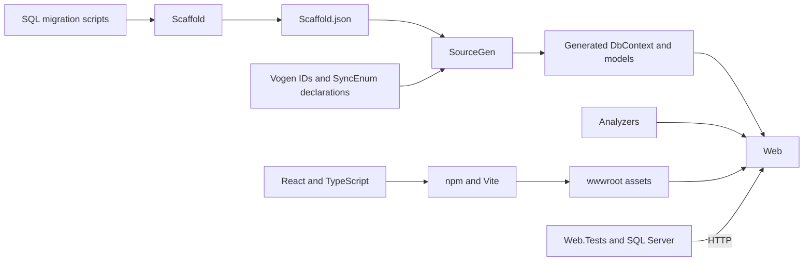

# A Template Project for Vertical Slice Architecture

This is an opinionated, runnable example of **a** vertical slice architecture, rather than a prescription for every
application. It combines an ASP.NET Core API with a React and TypeScript frontend for managing tenants,
organizations, people, and roles. Its purpose is both to provide a starting point for an application and to explain
why the pieces are arranged this way.

The main choices are compile-time handler dispatch and endpoint registration, explicit SQL migrations with generated
LinqToDB models, strongly typed IDs, and authorization decisions supplied by caches. Features own their business
operations instead of routing every change through a shared service layer.

- [Build and run](#build-and-run)
- [Projects and how they interact](#projects-and-how-they-interact)
- [Architectural choices](#architectural-choices)
- [Repository guides for contributors and agents](docs/index.md)

## Build and run

### Prerequisites

- .NET 11 SDK.
- Node.js 22.12 or later and npm.
- SQL Server 2025; the migrations use its native `json` type.
- An SMTP relay/inbox or a Resend account to deliver email sign-in codes. The public homepage can run without
  email delivery, but completing a browser login requires a working transport.
- Docker to run the integration tests or build the application container. A separately managed SQL Server can be
  used for local application development and schema scaffolding.

The scaffolder and the application use SQL Server for different purposes. The scaffolder creates and drops a temporary
database to discover the schema. The application uses a persistent database containing application data. Give these
identities the permissions appropriate to their jobs rather than using the scaffolder's elevated identity at runtime.

### Configure the database and authentication

Create `Web/Secrets.targets` with the scaffolder's connection string:

```xml
<Project>
  <PropertyGroup>
    <ScaffoldConnectionString>Server=localhost%3BUser ID=sa%3BPassword=your-password%3BTrustServerCertificate=true</ScaffoldConnectionString>
  </PropertyGroup>
</Project>
```

Use `%3B` for semicolons in this MSBuild property. This connection must allow the scaffolder to create and drop a
temporary database. Then create a separate, empty application database and add `Web/secrets.json`:

```json
{
  "DbContextOptions": {
    "ConnectionString": "Server=localhost;Database=VsaTemplate;User ID=app-user;Password=your-password;TrustServerCertificate=true"
  },
  "EmailServiceOptions": {
    "ServerType": "Smtp",
    "SmtpServer": "localhost",
    "SmtpPort": 1025,
    "FromEmailAddress": "VsaTemplate <no-reply@example.com>",
    "AdminEmailAddresses": []
  }
}
```

The SMTP example assumes a local relay or development inbox listening on port 1025. For example, start a local
[Mailpit](https://mailpit.axllent.org/) inbox with Docker:

```sh
docker run --rm --name vsatemplate-mail \
  -p 127.0.0.1:1025:1025 -p 127.0.0.1:8025:8025 axllent/mailpit
```

Open `http://localhost:8025` to read the sign-in code. The current SMTP adapter accepts a host and port for a relay;
it does not expose SMTP username/password settings. For a Resend transport, replace the email section in your settings
with the following and use a sender verified for your Resend account:

```json
{
  "EmailServiceOptions": {
    "ServerType": "Resend",
    "ResendApiToken": "your-resend-api-token",
    "FromEmailAddress": "VsaTemplate <no-reply@your-domain.example>",
    "AdminEmailAddresses": []
  }
}
```

Login messages go to the submitted email address in every environment. Other application email can use the configured
administrator-address redirect during development; that redirect must not intercept sign-in codes. With
`ServerType: "Disabled"`, the homepage still renders but requesting a login code returns an explicit delivery-unavailable
response. Codes are not printed in the server console or returned in the API response.

At startup, the server applies outstanding migrations to the application database. If migrations require a separate
identity, provide `DbContextOptions:ConnectionStringInit`. Neither secrets file should be committed. Production hosts
can supply the same configuration through their configuration or secret providers.

Any authenticated user can create a tenant and becomes its first administrator. The optional `OVERRIDEROOTUSER`
configuration value gives the specified email address global administrative access; it is not required to create the
first tenant. Configure that account deliberately when using the bootstrap option.

### Run the application

From the repository root:

```sh
dotnet run --project Web
```

The `Web` build runs `npm ci` when the frontend package manifests change, typechecks and builds the frontend when
its inputs change, and copies its output into the generated `Web/wwwroot` directory. The development launch profile
serves the application at `http://localhost:5106` or `https://localhost:7013`.

For frontend hot reload, leave the backend running and start Vite in a second terminal:

```sh
cd Web/ClientApp
npm ci
npm run dev
```

Open `http://localhost:5173`. Vite proxies API and authentication requests to `http://localhost:5106` by default;
set `WEB_API_URL` if the backend uses another origin.

On the public homepage, choose the login button and provide an email address. After the request succeeds, the email field
is disabled and a field for the six-digit code appears. Read the code in that email inbox and enter it in the same tab or
window within 15 minutes. A successful verification consumes the code and signs the user in with a session cookie. The
public page and login panel remain separate so a fork can replace the public content without redesigning authentication.

Open `VsaTemplate.slnx` in Visual Studio and expand `Web/ClientApp` under `Web` to review the React components,
TypeScript, styles, and npm configuration. The frontend is part of the existing C# project. There is no separate
JavaScript project to keep synchronized. Set `Web` as the startup project to serve the compiled UI, or run Vite alongside
it for frontend development.

### Run checks

From `Web/ClientApp`:

```sh
npm run check
npm run build
```

`check` runs strict TypeScript checking and frontend tests. `build` produces the production assets with Vite.

From the repository root:

```sh
dotnet test --project Web.Tests/Web.Tests.csproj
```

The backend tests start disposable SQL Server containers and an ASP.NET Core application factory, then make HTTP
requests against the application. Login tests capture messages through a test email sender; they do not require an external
mail provider or print real login codes. Docker must be available, and an ordinary build still needs the scaffolder's
connection string described above.

### Publish

```sh
dotnet publish Web/Web.csproj -c Release -o ./publish
```

Publish includes the frontend in `publish/wwwroot`. The server serves the UI and API from the same origin, including
frontend route fallback, while unknown API routes keep their HTTP 404 responses. Frontend source changes invalidate
the incremental build, and obsolete generated assets are removed before the current assets are included. Generated
output and npm dependencies are excluded from source control and frontend source is excluded from server publishing.

For a container build, put the scaffolder's connection string in a file and supply it as a BuildKit secret:

```sh
docker build --secret id=ScaffoldConnectionString,src=/path/to/scaffold-connection-string \
  -f Web/dockerfile -t vsatemplate .
```

The Node stage restores packages from the npm lockfile and builds the frontend. The .NET stage publishes the server
with those assets. The final ASP.NET Core image runs as the `app` user on port 8080. The scaffolding database must be
reachable from the build container; runtime database and email-delivery settings are supplied when starting the image.

If the frontend was built separately, `-p:BuildFrontend=false` uses the existing `Web/ClientApp/dist` output and skips
npm. The build fails if that output is missing. Normal local builds and publishes do not need this option.

## Projects and how they interact

The support projects participate in the application's build. They are separate because inspecting SQL, generating C#,
and checking C# conventions solve different problems and run at different stages.

| Project or directory | Purpose | Relationship to the rest of the application |
| --- | --- | --- |
| `Scaffold` | An executable that creates a temporary database, applies the migration scripts, and inspects the resulting SQL schema. | The `Web` build runs it through `Scaffold.targets` to produce `Web/Database/Models/Scaffold.json`. |
| `SourceGen` | Roslyn generators that turn the schema description and application declarations into C#. | Referenced by `Web` as an analyzer; generates the partial `DbContext`, database models, Vogen mappings, and synchronization for enums marked `[SyncEnum]`. |
| `Analyzers` | Roslyn diagnostics enforcing repository conventions. | Referenced by `Web` as an analyzer, so mistakes are reported while editing and building. |
| `Web` | ASP.NET Core startup, JSON endpoints, business features, database initialization, and production UI hosting. | Combines generated models and registered handlers with infrastructure and serves the published frontend. |
| `Web/ClientApp` | React and TypeScript application, with npm managing its dependencies and Vite building its assets. | Lives inside `Web`; MSBuild invokes the npm pipeline and includes only its compiled assets in the server deployment. |
| `Web.Client` | A foundation for C# API clients using Refit. | Client contracts can provide typed HTTP access to `Web`; the current integration tests also use `HttpClient` directly. |
| `Web.Tests` | Tests of application behavior through HTTP, using a real SQL Server schema. | Starts `Web` with test authentication and a disposable database; exercises the composition of routing, validation, authorization, caching, and persistence. |

The database build path is:



The generated models describe the schema that the SQL scripts actually create. This avoids maintaining one schema in
migration scripts and a second, independently edited schema in ORM classes. At runtime, the same embedded scripts are
compared with the database's version history and outstanding scripts are applied in filename order.

## Architectural choices

### Vertical slices and typed feature folders

Business code lives under `Web/Features`, organized by the concept being changed: `AccessControl`, `Tenants`, and
`Organizations`. A feature's endpoints, queries, models, services, and authorization rules are kept together so a reader
can follow one use case without moving through a repository-wide controller/service/repository hierarchy.

Subfolders communicate what their members do. `Endpoints` contains HTTP-mapped operations; `Queries` contains internal
reads; `Models` contains feature data and IDs; `Services` contains reusable operations; `Authorization` contains scoped
request contracts and behaviors. Keep a cache's direct backing query in the same file as the cache. A shared validation
or management helper belongs with services or validators.

`Web/Infrastructure` contains application mechanics such as authentication, email delivery, logging, and exception
handling. `Web/Database` owns persistence setup and migrations. `Features/Shared` is for feature code used across slices;
sharing a helper should follow an actual shared need rather than becoming a default layer through which every operation
must pass.

### Compile-time dispatch with Immediate.Handlers

[Immediate.Handlers](https://github.com/ImmediatePlatform/Immediate.Handlers) implements the command-dispatch pattern,
often called the mediator pattern. It generates typed links between requests, responses, handlers, and behaviors at
compile time. A feature can express an operation as a request and handler while common concerns run through the handler
pipeline, without a runtime lookup convention tying the application together.

The pipeline includes logging, global and scoped authorization, and validation. For example, an HTTP tenant operation
passes through authentication, then its handler pipeline evaluates global access, tenant permissions, and input
validation before invoking business code. Non-HTTP internal queries can use the same handler mechanism without being
exposed as endpoints.

[Immediate.Apis](https://github.com/ImmediatePlatform/Immediate.Apis) generates ASP.NET Core Minimal API registrations
from mapping attributes such as `[MapGet]`. This keeps the HTTP mapping beside the operation it exposes rather than
requiring a separate, manually synchronized route registry.

[Immediate.Validations](https://github.com/ImmediatePlatform/Immediate.Validations) generates request validation.
`ValidationBehavior<,>` applies validation through the handler pipeline, making validation part of executing an operation
rather than a convention each HTTP caller must remember.

[Immediate.Injections](https://github.com/ImmediatePlatform/Immediate.Injections) generates service and options
registration from declarations such as `[RegisterScoped]` and `[RegisterOptions]`. This keeps a service's lifetime and
configuration binding close to its definition while avoiding a growing manual registration list in startup.

### Caches are an authorization boundary

[Immediate.Cache](https://github.com/ImmediatePlatform/Immediate.Cache) supplies cached execution of selected handlers.
The query behind a cache owns the database reads needed to produce an authorization answer, including activity state
and effective permissions. Authorization behaviors consume those answers; they do not run their own database queries.
This gives eligibility one definition and keeps the behavior concerned with deciding whether a request may continue.

Permission changes, role assignments, and activation changes must invalidate every affected view after the mutation
commits. Caching access decisions is useful only if granting and revoking access remain correct on subsequent requests.

Tenant and organization access are separate scopes. A tenant groups organizations, but a person can belong to one
organization without belonging to its tenant. Removing tenant membership does not remove independently assigned
organization membership. The scope's own activity and permissions determine its ordinary authorization answer.
An inactive tenant returns `[]` from its ordinary permission cache, making that tenant unavailable to ordinary scoped
operations. Explicit lifecycle administration, such as restoration, is handled separately from ordinary access.

The scoped request contracts have a virtual permission demand defaulting to `None`. An operation that needs only base
membership can use that default; an operation that manages members or settings supplies a stronger demand. An empty
permission set means no usable access, while a nonempty set containing `None` represents base membership.

### SQL-first persistence with LinqToDB

Many C# templates use Entity Framework Core. This template chooses [LinqToDB](https://github.com/linq2db/linq2db) for
its query and SQL capabilities, while keeping SQL migration scripts as the source of database structure. This is a
choice about how to work with persistence, rather than a requirement of vertical slice architecture; the feature and
handler ideas can be used with another ORM.

New scripts under `Web/Database/Scripts` are additive and named so an ordinal filename sort gives their execution order.
Do not edit a migration that may already have run against a database. The scaffolder applies the scripts to a temporary
database during the build, and the resulting schema description feeds `SourceGen`. Runtime migration history records
which embedded scripts have already run against the application database.

SQL Server is an intentional implementation choice. The current migrations depend on SQL Server features, including
native JSON and temporal tables. Porting to another provider requires revisiting those scripts and queries; changing an
ORM provider setting alone is not enough.

### Strongly typed IDs with Vogen

[Vogen](https://github.com/SteveDunn/Vogen) gives IDs distinct types such as `TenantId`, `OrganizationId`, and `UserId`.
Although they may share an integer representation, the types prevent accidentally passing one kind of identifier where
another is expected. `SourceGen` connects these declarations to generated LinqToDB mappings, and the OpenAPI integration
exposes their underlying representations to HTTP clients.

### Compiler-enforced conventions

The `Analyzers` project makes several design preferences visible in the editor and build:

- `VSA0001` checks that HTTP handler requests participate in authorization through `IAuthorizedRequest`.
- `VSA0002` discourages positional record constructors, which are awkward for database projections and easy to break
  when a record's shape changes. Request and response records use named properties instead.
- `VSA0003` requires database entities to be referenced through their `Database.Models` qualification. This makes
  persistence entities recognizable and helps keep them distinct from feature contracts.

These analyzers complement tests: a compiler check can catch a missing convention, but cannot prove that the permissions,
transaction boundaries, or database changes implement the intended behavior.

### A browser application alongside the API

React and TypeScript provide the browser UI. The app uses shadcn/ui and Tailwind CSS, with a layout and light and dark
palettes adapted from the Immediate.Jobs dashboard. System, Light, and Dark are available on the public and signed-in
pages, and the preference is saved in the browser. See the [frontend contributor guide](docs/contributing.md#working-on-the-frontend).
The frontend uses npm's committed lockfile and an ordinary Vite build. Keeping it under `Web` makes the server's build and
publish responsible for the UI it serves, while Vite still provides its own development loop. Serving the production API
and UI from one origin keeps deployment and cookie-based authentication straightforward.

The frontend hides unavailable actions to explain access to the user. The API remains responsible for enforcing access;
a hidden button is not an authorization boundary. Cookie-authenticated mutations use antiforgery tokens, and API-key
clients authenticate separately for machine access.

### Email codes for browser authentication

Browser authentication uses an emailed one-time code, leaving the application free of password storage and external
identity-provider setup. This keeps a fork's starting point understandable: mailbox control establishes identity, while
the application's own roles and cached permissions decide what that identity can do.

The client generates an unpredictable session identifier and keeps it in `sessionStorage` for the requesting tab. It sends
that identifier when requesting the code and again when verifying it, so the code alone cannot complete a login in another
window. The browser also handles duplicated-tab storage rather than assuming a copied `sessionStorage` value identifies
a new tab. The server generates a cryptographically secure six-digit number, enforces the 15-minute lifetime, and consumes
a successful challenge atomically. A code is usable once; wrong attempts and request frequency are limited.

Challenges are persisted in SQL Server, with hashes of the session and token material rather than their raw values. This
lets verification and consumption remain consistent across application instances. Database-backed data-protection keys
allow those instances to validate the same authentication cookies. The browser's anonymous session endpoint supplies an
antiforgery token before login requests, so requesting and verifying a code use the same request protection as other
cookie-backed changes.

See the [authentication guide](docs/authentication.md) for the protocol, email configuration, deployment considerations,
and the boundaries that should remain intact when extending the flow.

### Integration tests over mocked persistence

The tests favor HTTP integration scenarios because many important behaviors cross boundaries: request binding, generated
handlers, validation, scoped authorization, cache invalidation, SQL transactions, and response serialization. A mocked
repository cannot demonstrate that those pieces agree with the actual migration scripts and SQL Server behavior.

`ApplicationFactoryFixture` starts SQL Server through Testcontainers and hosts the application through ASP.NET Core's
application factory. Tests seed users and make requests with controlled identities. Frontend tests exercise the UI and
its HTTP contract separately. Focused unit tests remain appropriate for isolated rules; they do not replace checking the
composed application when a change depends on its infrastructure.

## Working on a fork

Start by reading a feature from its endpoint through the handler and database query, then inspect the build path above
before changing the schema. The template is intentionally small enough to trace those connections. Adapt the choices
to the application being built, and keep the explanations synchronized when an architectural decision changes.

The [repository guides in `/docs`](docs/index.md) describe enduring architecture and contributor conventions for both
human contributors and LLM agents. They are maintained guides, not a task diary or a list of answers from past chats.
